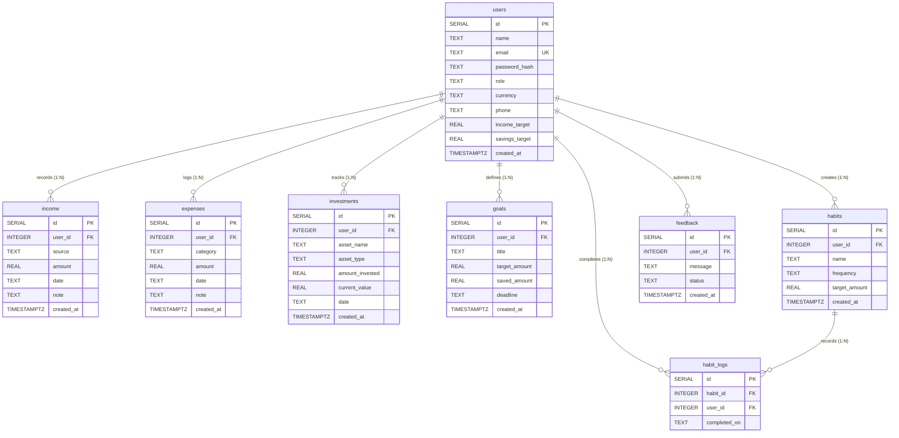
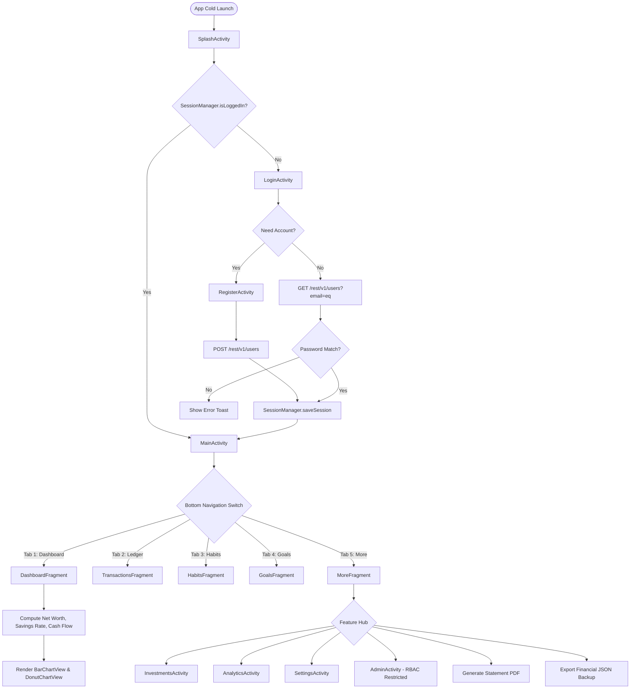

# WealthPulse – Native Android Wealth Intelligence & Financial Command Center

<div align="center">


-10B981?style=for-the-badge&logo=gradle&logoColor=white)

<p align="center">
  <b>WealthPulse</b> is an enterprise-grade, 100% native Android personal finance, habit intelligence, and wealth portfolio management application. Built strictly with <b>Java 11</b> and <b>Material Design 3 XML</b>, it integrates directly with a cloud-native <b>Supabase PostgreSQL</b> database via high-performance PostgREST HTTP endpoints.
</p>

</div>

---

## Table of Contents
1. [Core Features & Engineering Highlights](#1-core-features--engineering-highlights)
2. [Technology Stack & Dependencies](#2-technology-stack--dependencies)
3. [Database Architecture (Supabase / PostgreSQL)](#3-database-architecture-supabase--postgresql)
   - [Entity-Relationship Diagram](#entity-relationship-diagram)
   - [Schema Definition & Constraints](#schema-definition--constraints)
   - [Row-Level Security (RLS) & Anon Access](#row-level-security-rls--anon-access)
4. [Application Architecture & Flow](#4-application-architecture--flow)
   - [System Architecture](#system-architecture)
   - [End-to-End User Flow](#end-to-end-user-flow)
   - [Custom Hardware-Accelerated 2D Canvas Engine](#custom-hardware-accelerated-2d-canvas-engine)
   - [Dynamic 3-Theme Runtime Switcher](#dynamic-3-theme-runtime-switcher)
   - [Native Canvas PDF Statement Generator](#native-canvas-pdf-statement-generator)
   - [Password Visibility & Input UX Controls](#password-visibility--input-ux-controls)
   - [Android 15 Edge-to-Edge & Responsive Typography](#android-15-edge-to-edge--responsive-typography)
5. [Directory & Package Structure](#5-directory--package-structure)
6. [Getting Started & Local Setup](#6-getting-started--local-setup)
   - [Prerequisites](#prerequisites)
   - [Supabase Backend Setup](#supabase-backend-setup)
   - [Building & Running the App](#building--running-the-app)
   - [Generating APK / Releases](#generating-apk--releases)
7. [License](#7-license)

---

## 1. Core Features & Engineering Highlights

- **100% Pure Native Execution**: Zero WebViews, zero hybrid overhead (no Flutter, no React Native). Direct ART bytecode execution with hardware-accelerated rendering.
- **Comprehensive Net Worth & Portfolio Tracking**:
  - Real-time aggregation of liquid cash savings and multi-asset investment holdings.
  - Multi-asset class support: Stocks, Mutual Funds, Index ETFs, Gold, Fixed Deposits (FD), PPF / EPF, Real Estate, and Cryptocurrency.
  - Instant capital gain/loss ($ and %) computation with dynamic color indicator tagging.
- **Double-Entry Style Cash Flow Ledger**:
  - Filter transactions by *All*, *Income*, or *Expense* with instant responsive updates.
  - Categorized expenditures and income logging with notes, date-stamps, and monthly historical filtering.
- **Positive Habit Intelligence Engine**:
  - Daily financial routine tracking (e.g. *Zero Impulse Spending*, *Weekly Portfolio Rebalancing*).
  - One-tap check-in toggles with streak computation and flame badge visualization.
- **Milestone Savings Goals**:
  - Visual linear progress tracking against user-defined financial targets with progress percentages.
  - Direct contribution dialogs incrementing saved amounts with immediate database synchronization.
- **Custom Hardware-Accelerated 2D Canvas Charts**:
  - `BarChartView.java`: Double-bar comparative 6-month historical cash flow trends with rounded bar heads and dynamic Y-axis scaling.
  - `DonutChartView.java`: Trigonometric multi-category spending distribution arcs with anti-aliasing and interactive category legends.
- **Dynamic 3-Theme Multi-Palette Engine**:
  - **Dark Slate**: Ultra-modern OLED deep dark theme.
  - **Clean Light**: Crisp minimalist corporate light theme.
  - **Executive Indigo**: Royal midnight indigo-blue aesthetic.
  - Live runtime switching with state preservation without requiring application reboots.
- **Native Vector PDF & JSON Backup Portability**:
  - On-device financial audit statements generated via Android's native `android.graphics.pdf.PdfDocument`.
  - Secure file dispatch via Android `FileProvider` sandboxing.
  - Complete JSON backup export for independent data ownership.
- **Role-Based Governance (RBAC)**:
  - Role separation (`user` vs `admin`).
  - Dedicated admin console (`AdminActivity`) for user governance, role elevation, and feedback management.
- **Modern Security & Input Polish**:
  - Show/Hide password toggle across all authentication and password dialogs with typeface and cursor preservation (`PasswordUtils.java`).
  - Autofill overlay collision suppression ensuring smooth text selection, copy, and paste.

---

## 2. Technology Stack & Dependencies

### Mobile Platform & Native Framework
| Layer | Specification | Details |
| :--- | :--- | :--- |
| **Language** | Java 11 | Bytecode compiled targeting JVM 11 / Android ART |
| **Target SDK** | Android 37 (API 37) | Android 15 / 16 Preview |
| **Minimum SDK**| Android 24 (API 24) | Compatible with >95% of active global devices (Android 7.0+) |
| **Architecture** | Single-Activity + Multi-Fragment | `MainActivity` managing 5 core feature fragments + dedicated deep activities |
| **UI Toolkit** | Material Design 3 (M3) | Declarative XML, ConstraintLayout 2.1.4, MaterialCardView, CoordinatorLayout |
| **View Binding** | Android ViewBinding | Compile-time null-safety and zero reflection overhead |

### Gradle Libraries & Dependencies

```kotlin
dependencies {
    // AndroidX & Core UI
    implementation(libs.activity.ktx)               // Modern Activity lifecycle & back-press handlers
    implementation(libs.appcompat)                  // Backward compatibility support
    implementation(libs.constraintlayout)           // Flat-hierarchy responsive XML layouts
    implementation(libs.material)                   // Google Material Design 3 components
    implementation(libs.swiperefreshlayout)         // Native pull-to-refresh container
    implementation(libs.viewpager2)                 // Touch-driven tab paging

    // Networking & Backend Communication
    implementation(libs.retrofit)                   // Type-safe HTTP client for PostgREST
    implementation(libs.retrofit.converter.gson)    // JSON-to-Java POJO converter
    implementation(libs.okhttp)                     // Connection pooling & HTTP/2 transport
    implementation(libs.okhttp.logging)             // Full body network logging for diagnostics
    implementation(libs.gson)                       // Serialization / Deserialization engine

    // Testing
    testImplementation(libs.junit)                  // Unit test runner
    androidTestImplementation(libs.espresso.core)   // Android UI test automation
    androidTestImplementation(libs.ext.junit)       // AndroidX JUnit integration
}
```

---

## 3. Database Architecture (Supabase / PostgreSQL)

WealthPulse uses a cloud-hosted **PostgreSQL 15+** database provisioned on **Supabase**, communicating directly via Supabase's managed **PostgREST** gateway.

### Entity-Relationship Diagram



### Schema Definition & Constraints

1. **Primary & Foreign Keys**: All tables use auto-incrementing `SERIAL PRIMARY KEY`. Every financial record binds strictly to `users(id)`.
2. **Cascade Deletion (`ON DELETE CASCADE`)**: When a user invokes account deletion from `SettingsActivity`, PostgreSQL's cascade engine immediately wipes all associated incomes, expenses, investments, goals, habits, and habit logs.
3. **Audit Log Referential Integrity (`ON DELETE SET NULL`)**: `feedback` references `users(id)` with `ON DELETE SET NULL` so operational support metrics remain intact even if user profiles are deleted.
4. **Unique Daily Habit Constraint**: `habit_logs` enforces `UNIQUE (habit_id, completed_on)`, preventing duplicate habit check-ins on the same day at the database constraint level.

### Row-Level Security (RLS) & Anon Access

To enable seamless direct client-to-database communication with Supabase's publishable Anon Key, tables are configured with public read/write access (or RLS disabled for mobile BaaS architecture):

```sql
-- Disable RLS for mobile BaaS architecture (Recommended)
ALTER TABLE users DISABLE ROW LEVEL SECURITY;
ALTER TABLE feedback DISABLE ROW LEVEL SECURITY;
ALTER TABLE investments DISABLE ROW LEVEL SECURITY;
ALTER TABLE goals DISABLE ROW LEVEL SECURITY;
ALTER TABLE habits DISABLE ROW LEVEL SECURITY;
ALTER TABLE habit_logs DISABLE ROW LEVEL SECURITY;
ALTER TABLE expenses DISABLE ROW LEVEL SECURITY;
ALTER TABLE income DISABLE ROW LEVEL SECURITY;
```

---

## 4. Application Architecture & Flow

### System Architecture

```
┌─────────────────────────────────────────────────────────────────────────┐
│                     WealthPulse Native Android Client                   │
│   Activities  │  Fragments  │  Custom 2D Canvas  │  SessionManager      │
└────────────────────────────────────┬────────────────────────────────────┘
                                     │
                          Retrofit 2 + OkHttp 3
                       (with SupabaseInterceptor)
                                     │
                                     ▼
┌─────────────────────────────────────────────────────────────────────────┐
│                        PostgREST REST Gateway                           │
│               https://<project-ref>.supabase.co/rest/v1/                │
└────────────────────────────────────┬────────────────────────────────────┘
                                     │
                                     ▼
┌─────────────────────────────────────────────────────────────────────────┐
│                       Supabase PostgreSQL Engine                        │
│            (8 Tables, Foreign Keys, Cascade Deletes, Indexes)           │
└─────────────────────────────────────────────────────────────────────────┘
```

### End-to-End User Flow



### Custom Hardware-Accelerated 2D Canvas Engine

WealthPulse uses zero third-party chart libraries (no MPAndroidChart or bloated webview charts). Instead, it features custom Android 2D `Canvas` and `Paint` views:
- **`BarChartView.java`**:
  - Dynamically calculates scale maxima based on historical income and expense transactions across 6 calendar months.
  - Renders double-column rounded bar pillars with gradient fills.
  - Automatically draws responsive typography labels and gridlines.
- **`DonutChartView.java`**:
  - Calculates radial sweep angles dynamically ($\theta_i = 360^\circ \times \frac{\text{amount}_i}{\sum \text{amount}}$).
  - Anti-aliased stroke drawing with hollow center for net expense summation.
  - Dynamic category color legend mapping.

### Dynamic 3-Theme Runtime Switcher

WealthPulse includes a runtime theme management system implemented via `ThemeManager.java`:
1. **Dark Slate (`Theme.WealthPulse.DarkSlate`)**: Optimized for high-contrast OLED battery saving.
2. **Clean Light (`Theme.WealthPulse.CleanLight`)**: Crisp, daylight-readable corporate palette.
3. **Executive Indigo (`Theme.WealthPulse.ExecutiveIndigo`)**: Deep royal indigo aesthetic.

Theme changes notify all active screens with zero data loss or unresponsiveness.

### Native Canvas PDF Statement Generator

Implemented in `PdfReportGenerator.java`, statements are compiled on-device with zero server-side rendering:
- Direct rendering using `android.graphics.pdf.PdfDocument`.
- Vector-rendered tables for Income, Expense, Goals, Habits, and Net Worth breakdown.
- Uses Android `FileProvider` (`file_paths.xml`) to securely share PDFs directly via WhatsApp, Gmail, Drive, or Print Spooler.

### Password Visibility & Input UX Controls

- **`PasswordUtils.java`**: Universal helper that binds to password input fields and eye toggle buttons. Preserves text cursor position, range selection, and font typeface when toggling between obscured (`••••••••`) and plain text modes.
- **Autofill & Selection Polish**: Autofill overlay interception is suppressed on name and phone inputs (`importantForAutofill="no"`), and themed selection highlights (`textColorHighlight`) ensure clean, visible text selection and action bar (Cut/Copy/Paste) support.

### Android 15 Edge-to-Edge & Responsive Typography

- Full compatibility with Android 15 edge-to-edge drawing via `ViewCompat.setOnApplyWindowInsetsListener` and `android:fitsSystemWindows="true"`.
- Typography and layouts dynamically scale across compact, medium, and large phone displays without text truncation.

---

## 5. Directory & Package Structure

```text
FinancialTracker/
├── app/                                        # Native Android Application Module
│   ├── src/
│   │   ├── main/
│   │   │   ├── java/com/example/financialtracker/
│   │   │   │   ├── activities/                # Flow Activities
│   │   │   │   │   ├── AdminActivity.java     # Admin governance console (RBAC protected)
│   │   │   │   │   ├── AnalyticsActivity.java # Deep analytical breakdowns & trends
│   │   │   │   │   ├── FeedbackActivity.java  # Support feedback submission & audit logs
│   │   │   │   │   ├── InvestmentsActivity.java# Asset portfolio tracker (P&L calculations)
│   │   │   │   │   ├── LoginActivity.java     # Authentication screen
│   │   │   │   │   ├── RegisterActivity.java  # New user registration screen
│   │   │   │   │   ├── SettingsActivity.java  # Profile, theme selector, password change
│   │   │   │   │   └── SplashActivity.java    # Cold-launch session validator
│   │   │   │   ├── adapters/                  # High-performance RecyclerView adapters
│   │   │   │   │   ├── AdminFeedbackAdapter.java
│   │   │   │   │   ├── AdminUserAdapter.java
│   │   │   │   │   ├── GoalAdapter.java
│   │   │   │   │   ├── HabitAdapter.java
│   │   │   │   │   ├── InvestmentAdapter.java
│   │   │   │   │   └── TransactionAdapter.java# Unified ledger adapter (Income & Expenses)
│   │   │   │   ├── fragments/                 # Core bottom navigation tabs
│   │   │   │   │   ├── DashboardFragment.java # Real-time metrics & Canvas chart views
│   │   │   │   │   ├── GoalsFragment.java     # Savings goals, progress bars, contributions
│   │   │   │   │   ├── HabitsFragment.java    # Daily habits, streaks, check-in toggles
│   │   │   │   │   ├── MoreFragment.java      # Feature hub (Investments, PDF, Backup, etc.)
│   │   │   │   │   └── TransactionsFragment.java# Income & Expense management ledger
│   │   │   │   ├── models/                    # Data Transfer Objects (DTOs) & Entities
│   │   │   │   │   ├── AdminStats.java
│   │   │   │   │   ├── AdminUserItem.java
│   │   │   │   │   ├── AnalyticsSummary.java
│   │   │   │   │   ├── ApiResponse.java
│   │   │   │   │   ├── AuthResponse.java
│   │   │   │   │   ├── CategoryData.java
│   │   │   │   │   ├── ChangePasswordRequest.java
│   │   │   │   │   ├── Expense.java
│   │   │   │   │   ├── ExpenseRequest.java
│   │   │   │   │   ├── ExportDataResponse.java
│   │   │   │   │   ├── FeedbackItem.java
│   │   │   │   │   ├── FeedbackRequest.java
│   │   │   │   │   ├── FeedbackStatusRequest.java
│   │   │   │   │   ├── Goal.java
│   │   │   │   │   ├── GoalContributeRequest.java
│   │   │   │   │   ├── GoalRequest.java
│   │   │   │   │   ├── Habit.java
│   │   │   │   │   ├── HabitLog.java
│   │   │   │   │   ├── HabitRequest.java
│   │   │   │   │   ├── HabitToggleResponse.java
│   │   │   │   │   ├── Income.java
│   │   │   │   │   ├── IncomeRequest.java
│   │   │   │   │   ├── Investment.java
│   │   │   │   │   ├── InvestmentRequest.java
│   │   │   │   │   ├── InvestmentUpdateRequest.java
│   │   │   │   │   ├── LoginRequest.java
│   │   │   │   │   ├── MonthlyData.java
│   │   │   │   │   ├── RegisterRequest.java
│   │   │   │   │   ├── RoleUpdateRequest.java
│   │   │   │   │   ├── UpdateProfileRequest.java
│   │   │   │   │   └── User.java
│   │   │   │   ├── network/                   # Network & BaaS abstraction layer
│   │   │   │   │   ├── ApiClient.java         # Singleton factory for API service
│   │   │   │   │   ├── ApiService.java        # High-level domain service interface
│   │   │   │   │   ├── AuthInterceptor.java   # Bearer token injector
│   │   │   │   │   ├── SimpleCall.java        # Synchronous-to-asynchronous Call wrapper
│   │   │   │   │   ├── SupabaseConfig.java    # Cloud URL and Anon Key configuration
│   │   │   │   │   ├── SupabaseInterceptor.java# PostgREST header injector
│   │   │   │   │   ├── SupabaseRawApi.java    # Retrofit PostgREST HTTP definitions
│   │   │   │   │   └── SupabaseService.java   # Concrete BaaS implementation & analytics
│   │   │   │   ├── utils/                     # Utility Services
│   │   │   │   │   ├── FormatUtils.java       # Currency, date, and decimal formatting
│   │   │   │   │   ├── PasswordUtils.java     # Universal password show/hide eye toggle
│   │   │   │   │   ├── PdfReportGenerator.java# Native Canvas multi-page PDF generation
│   │   │   │   │   ├── SessionManager.java    # SharedPreferences session persistence
│   │   │   │   │   └── ThemeManager.java      # Dynamic 3-theme runtime switcher
│   │   │   │   ├── views/                     # Custom Hardware-Accelerated 2D Views
│   │   │   │   │   ├── BarChartView.java      # 6-month comparative cash-flow trend chart
│   │   │   │   │   └── DonutChartView.java    # Category spending distribution donut chart
│   │   │   │   └── MainActivity.java          # Root container with Material 3 BottomNav
│   │   │   ├── res/                           # 100% Native XML Resources
│   │   │   │   ├── color/                     # ColorStateList XML selectors
│   │   │   │   ├── drawable/                  # Vector icons, gradient cards, button drawables
│   │   │   │   ├── layout/                    # Activity, Fragment, and Dialog XML layouts
│   │   │   │   ├── menu/                      # Bottom navigation menu definition
│   │   │   │   ├── mipmap-*/                  # Density-scaled launcher icons (hdpi to xxxhdpi)
│   │   │   │   ├── values/                    # colors.xml, strings.xml, themes.xml (M3)
│   │   │   │   └── xml/                       # file_paths.xml (FileProvider configuration)
│   │   │   └── AndroidManifest.xml            # App permissions, components & FileProvider
│   │   └── test/                              # Automated unit tests
│   └── build.gradle.kts                       # App module build configuration & dependencies
├── gradle/
│   ├── libs.versions.toml                     # Centralized version catalog
│   └── wrapper/                               # Gradle wrapper binaries
├── supabase_schema.sql                        # Complete PostgreSQL database schema (8 tables)
├── build.gradle.kts                           # Root Gradle build script
├── settings.gradle.kts                        # Module definitions
└── README.md                                  # This documentation manual
```

---

## 6. Getting Started & Local Setup

### Prerequisites
- **Android Studio**: Android Studio Jellyfish (2023.3.1), Koala (2024.1.1), Ladybug (2024.2.1), or newer.
- **JDK**: Java Development Kit (JDK 11, 17, or 21 compatible).
- **Android Device / Emulator**: Running Android 7.0 (API 24) or higher.

### Supabase Backend Setup

1. Create a free project at [supabase.com](https://supabase.com/).
2. Navigate to your project's **SQL Editor** (`>_` icon).
3. Open [`supabase_schema.sql`](supabase_schema.sql) from the repository root, copy its content, paste it into the SQL Editor, and click **Run**.
4. In your Supabase project dashboard, copy your **Project URL** and **anon/public API key** from **Project Settings ➔ API**.
5. Update `app/src/main/java/com/example/financialtracker/network/SupabaseConfig.java`:

```java
public class SupabaseConfig {
    public static final String SUPABASE_URL = "https://<your-project-ref>.supabase.co/";
    public static final String REST_BASE_URL = "https://<your-project-ref>.supabase.co/rest/v1/";
    public static final String ANON_KEY = "<your-anon-publishable-key>";
}
```

### Building & Running the App

```bash
# 1. Clone the repository
git clone https://github.com/your-username/WealthPulse.git
cd WealthPulse

# 2. Compile and verify Java sources
./gradlew compileDebugJavaWithJavac

# 3. Assemble the Debug APK
./gradlew assembleDebug
```

In Android Studio:
1. Click **File ➔ Open** and select the `FinancialTracker` folder.
2. Wait for Gradle to sync dependencies.
3. Select your connected device or emulator in the toolbar.
4. Click the green **Run (`▶`)** button.

### Generating APK / Releases

- **Direct Debug APK**:
  Run `./gradlew assembleDebug`. The ready-to-install `.apk` will be output to:
  ```text
  app/build/outputs/apk/debug/app-debug.apk
  ```
- **Direct Installation via ADB**:
  ```bash
  adb install -r app/build/outputs/apk/debug/app-debug.apk
  ```
- **Official Signed Release APK / AAB**:
  In Android Studio: **Build ➔ Generate Signed Bundle / APK...** ➔ Select **APK** or **Android App Bundle** ➔ Provide or create your Keystore (`.jks`) ➔ Choose **release** ➔ **Finish**.

---

## 7. License

Distributed under the **MIT License**. See `LICENSE` for more information.

---

<div align="center">
  <b>WealthPulse</b> • Master Your Cash Flow • Compound Your Wealth
</div>
